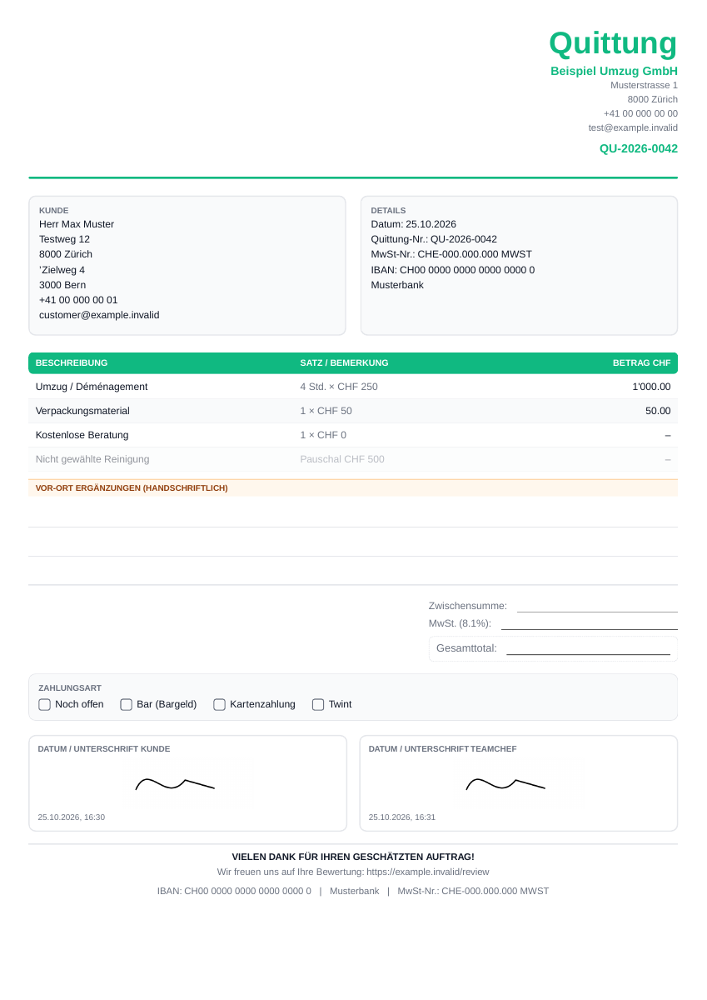

# Quittung (makbuz) oluşturma, mimari ve PDF inceleme raporu

**Tarih:** 25 Ekim 2026 — Asia/Bangkok  
**Gereksinim güncellemesi:** 26 Ekim 2026 — aşağıdaki kullanıcı kararları geliştirme kapsamını günceller; ilk incelemenin kanıtları tarihsel olarak korunmuştur.  
**İncelenen sürüm:** `1f7f8551` ve çalışma dizinindeki mevcut kaynaklar.  
**Kapsam:** Quittung oluşturma/düzenleme, Auftrag ve Offerte bağlantıları, hesaplama, imza, tahsilat, e-posta, PDF ve ilgili veri kuralları. Bu rapor Offerte/Quotation modülünün genel denetimi değildir.  
**İşlem:** İnceleme ve raporlama. Uygulama kodu, migration, üretim kaydı ve mevcut kullanıcı değişiklikleri değiştirilmedi; gerçek e-posta gönderilmedi.

## 0. Kullanıcının netleştirdiği kurallar — 26 Ekim 2026

### İsviçre ve belge karakterleri

**Kullanıcının netleştirdiği kapsam:** Belge dili ve sabit metinler İsviçre kullanımına uygun Almanca, Fransızca veya İngilizce olacak; Türkçe belge dili eklenmeyecek. **Müşteri adı ve adresi ise özgün karakterleriyle aynen korunacak.** Belgenin dili, müşteri kimlik/adres verisinin karakterlerini sınırlamaz.

İsim ve adreslerde Türkçe harfler dahil özgün karakterler dönüştürülmeyecek, kaldırılmayacak veya ASCII karşılıklarıyla değiştirilmeyecek. Bu nedenle Q13'teki ad/adres karakter bozulması düzeltme kapsamındadır; bu düzeltme Türkçe arayüz veya Türkçe belge çevirisi eklemek anlamına gelmez. PDF fontu hem DE/FR/EN sabit metinleri hem müşteri verisindeki özgün karakterleri doğru göstermelidir.

### Doğrudan tahsilat ve Rechnung üzerinden ödeme

**Kesinleşen kullanıcı isteği:** Doğrudan tahsilat alındığında makbuzda **“Ödendi / Bezahlt”** düğmesi bulunmalı. Müşteri Rechnung üzerinden ödeyecekse makbuz **açık / Offen** kalabilmeli. Bağlı Rechnung **ödendi / Bezahlt** olduğunda makbuz da ikinci bir manuel işlem gerektirmeden otomatik **ödendi** görünmeli.

| Ödeme takibi | Olay | Makbuzun ödeme durumu | Kayıt ilkesi |
|---|---|---|---|
| Doğrudan makbuz üzerinden | Tahsilat alındı; “Ödendi” düğmesi kullanıldı | Ödendi / Bezahlt | Gerçek tahsilat bir kez kaydedilir. |
| Rechnung üzerinden | Bağlı fatura henüz ödenmedi | Açık / Offen | Yeni makbuz tahsilatı oluşturulmaz. |
| Rechnung üzerinden | Bağlı fatura kısmen ödendi, hâlâ açık | Açık; kısmi tutar ayrıca gösterilebilir | Faturadaki mevcut ödeme kayıtları kullanılır. |
| Rechnung üzerinden | Bağlı fatura “Bezahlt” oldu | Otomatik Ödendi / Bezahlt | Durum fatura üzerinden izlenir; ikinci ödeme kaydı oluşturulmaz. |

Kısmi tutarın ayrıca gösterilmesi bir UI önerisidir; kısmi ödeme varken tam “Ödendi” gösterilmemesi fatura durumunu izleme kuralının sonucudur. İmza atılması veya e-posta gönderilmesi tek başına ödeme yapılmış sayılmaz. Açık makbuzda **“Zahlung per Rechnung — offen”**, kapanmış bağlı makbuzda **“Bezahlt über Rechnung …”** gibi açıklamalar önerilir; bunlar henüz uygulanmış metinler değildir.

**Teknik uygulama ilkeleri:**

- Quittung'un hangi Rechnung'ı takip ettiği açıkça bağlanmalı. Mevcut modelde doğrudan `rechnung_id` yok; yalnız aynı müşteri/teklif üzerinden tahminle eşleştirme yapılmamalı.
- Rechnung üzerinden ödeme izleniyorsa makbuzdaki düğme bağımsız ikinci tahsilat yazmamalı; gerekiyorsa bağlı faturanın ödeme kaydı akışına götürmeli.
- Faturanın ödeme durumunu izlemek için `record_quittung_payment` çağrılmamalı: bu RPC yeni tahsilat yaratır ve aynı parayı iki kez saydırır.
- Senkronizasyon yalnız tarayıcıda bir düğmeye basıldığı ana bağlı olmamalı. Sunucudaki durum/ödeme kaynağından türetilmeli veya aynı sunucu işlemi içinde güncellenmeli; açık ekrandaki durum da güncellenmeli.
- Fatura ödemesi ters kaydedilip fatura yeniden açılırsa bağlı makbuz da açık duruma dönmeli. Bu, durum takibinin tutarlılığı için önerilen ters yöndeki davranıştır; belge içeriği ve imza geçmişi korunmalıdır.
- Fatura alacak notuyla da `bezahlt` olabilir. Kullanıcının istediği durum eşleşmesi korunurken gerçek tahsilat tutarı, yöntemi ve tarihi uydurulmamalı; fatura kapanışı otomatik yeni nakit girişine çevrilmemelidir.

**Ek kabul ölçütleri:** Fatura açıkken makbuz açık; fatura ödendiğinde hem liste hem detay hem PDF ödeme göstergesi ödenmiş; aynı işlem iki kez işlendiğinde gelir artmıyor; açık bir bağlantı olmadan başka müşterinin/faturanın durumu makbuza yansımıyor. PDF'de “açık” gösterilebilmesi, bilinen hizmet tutarlarının zorunlu olarak boş bırakılması anlamına gelmez.

**Mevcut kaynaklar:** `quittung.types.ts:60–95`; `20260729110000_rechnung_offener_betrag.sql:45–58,86–119`; `20260729130000_quittung_ans_buch.sql:132–153`; `20260729120000_gutschriften_und_mahnungen.sql:174–183`.

Bu bölüm yeni iş kuralını belgeler. Otomatik Rechnung → Quittung ödeme takibi ve yeni detay düğmesi henüz uygulanmadı.

## 1. Genel değerlendirme

Quittung bölümündeki eksiklikler yalnız görsel değil. Ana sorun, **sahada elle doldurulan boş form, dijital olarak imzalanan hizmet belgesi ve alınan ödemeyi belgeleyen makbuzun aynı modelde birleştirilmiş olması**. `draft/signed/sent/paid` tek alanı hem düzenlenebilirliği hem imzayı hem gönderimi hem de PDF'de tutarların görünüp görünmeyeceğini yönetiyor. Bu olaylar birbirini dışlayan durumlar olmadığından farklı ekranlar çelişebiliyor.

Öncelikli sonuçlar:

- **Siparişin kabul edilmiş mali koşulları makbuza güvenilir biçimde taşınmıyor.** Opsiyonel kalemler ücrete dönüşebiliyor; vergi oranı ve indirim kaybolabiliyor.
- **İmza ile kaydedilen içerik arasında sağlam bağ yok.** Bir imzanın ekranda görünüp kayıt isteğinde bulunmadığı senaryo doğrulandı. İmzadan sonra müşteri/tarih gibi alanlar değiştirilebiliyor.
- **Müşteriye gönderilebilen PDF ile tamamlanmış makbuz birbirinden kopuk.** `signed/sent` PDF'lerinde toplamlar boş; tutarları basan `paid` durumunda normal detay ekranı gönderme düğmesi sunmuyor.
- **Tahsilatın iptali ve belge durumu tutarlı ilerlemiyor.** Ödeme defteri sıfırlanırken makbuz listesi eski geliri ve “ödendi” durumunu koruyabiliyor.
- **PDF'nin kimlik ve okunabilirlik sorunları var.** Müşteri adı/adresindeki özgün karakterler ve hedef adres sembolü bozuluyor; uzun belgelerde açıklama ile tutar ayrı sayfalara düşüyor; devam sayfalarında belge ve sayfa numarası yok. Ad/adres karakterlerinin korunması, kullanıcının netleştirdiği kapsamın parçasıdır.

Bu nedenle ilk geliştirme adımı yalnız PDF tasarımını değiştirmek olmamalı. Kullanıcının 26 Ekim kararıyla makbuzun fatura ödemesini beklerken açık kalabileceği ve fatura ödendiğinde otomatik kapanacağı netleşmiştir. Fiyat kaynağı ve içeriğin dondurulma aşaması bu iş kuralıyla birlikte uygulanmalıdır.

## 2. Yöntem, kanıt düzeyi ve sınırlar

Üç bağımsız inceleme hattının sonuçları birleştirildi: oluşturma/hesaplama akışı, veri ve gönderim katmanı, gerçek PDF çıktısı. Bulgular son migration tanımlarıyla karşılaştırıldı; eski dokümanlardaki iddialar doğrudan doğru kabul edilmedi.

| Kontrol | Sonuç ve kapsam |
|---|---|
| Mevcut test paketi | `npm test -- --reporter=dot`: **115 dosya, 2.177 test başarılı**. Bu, aşağıdaki kullanıcı akışlarının doğru olduğunu kanıtlamıyor. |
| Frontend tip kontrolü | `tsc -p tsconfig.app.json --noEmit --incremental false`: başarılı. |
| İlgili frontend dosyalarının lint kontrolü | 0 hata. `send-quittung` ESLint yapılandırması tarafından hariç tutuluyor; Edge için lint başarılı denmiyor. |
| Oluşturma ekranı | Gerçek `QuittungDetail` ve `SignaturePad`, Chromium/React ile çalıştırıldı. Şirket/auth/veri ve PDF gönderim adaptörleri sentetikti. Gerçek ekranın olay işleyicileri ve ürettiği payload doğrulandı. |
| Sipariş aktarımı | Gerçek kaynak fonksiyonları TypeScript AST ile çıkarılıp sentetik siparişlerle çalıştırıldı. React veya DB uçtan uca testi değildir. |
| PDF | Gerçek `QuittungPDF` ve `@react-pdf/renderer` ile **14 sentetik PDF** üretildi. DE/FR/EN, dört durum, Unicode, uzun alanlar, 50 kalem, imza, %0 vergi ve saat dilimleri incelendi. Metin çıkarımı ve görsel kontrol yapıldı. |
| Gönderim | Gerçek Edge handler, sahte Supabase/Resend adaptörleriyle çalıştırıldı. Kontrol akışı, tekrar istek ve hata davranışı doğrulandı; gerçek teslimat yapılmadı. |
| Veri katmanı | Migration zinciri ve yerel baseline okundu. Yerel test DB'sinde yalnız salt okunur katalog/fonksiyon ve `LPAD` sorguları kullanıldı. Veri değiştirilmedi. |
| Üretim sınırı | Canlı DB kayıtları, dağıtılmış uygulama ve gerçek müşteri makbuzları incelenmedi. Bulgular mevcut repo için geçerli; üretimde kaç kaydın etkilendiği ölçülmedi. |

**Kanıt etiketleri:** **Dinamik** = gerçek kaynak/renderer çalıştırılarak görüldü; **Statik** = kaynak ve SQL kontrol akışından doğrulandı; **Tasarım** = iş kuralı veya ürün kararı gerektiren eksik. Sahte DB'nin kabul ettiği bir isteğin gerçek DB'de de kabul edileceği varsayılmadı.

**Önemli düzeltme:** Arayüz imzalı makbuzu taslağa döndüren istek üretiyor; fakat `guard_quittung_status_regression` bunu normal uygulama rolleri için reddediyor. Bu rapor “imzalı belge taslağa döndürülerek kilidi açılabiliyor” iddiasında bulunmuyor.

## 3. Öncelik tablosu

**P1:** Yanlış tutar, yanlış alıcı, imza/içerik bütünlüğü veya tahsilat tutarsızlığı; ilk düzeltme grubuna alınmalı.  
**P2:** Kullanımı, belge doğruluğunu veya operasyon güvenilirliğini bozan sorun; P1 ile bağlantısına göre sıraya alınmalı. Öncelik, üretimde olay yaşandığı anlamına gelmez.

| No | Öncelik | Bulgu | Kanıt |
|---|---|---|---|
| Q01 | P1 | Opsiyonel kalemler otomatik ücretlendiriliyor | Dinamik |
| Q02 | P1 | Kaynak KDV oranı kayboluyor | Dinamik + statik |
| Q03 | P1 | İndirim kayboluyor; indirim alanı hiçbir durumda kullanılamıyor | Dinamik |
| Q04 | P1 | İki imza kaydedildi bildirimiyle eksik imza payload'ı | Dinamik |
| Q05 | P1 | İmzalı içerik tam dondurulmuyor | Dinamik UI + statik SQL |
| Q06 | P1 | İmzalı/gönderilmiş PDF'de toplam ve indirim yok | Gerçek PDF |
| Q07 | P2 | İlk doğrudan gönderimde PDF numarası boş | Dinamik |
| Q08 | P1 | Teklif değiştirirken önceki müşterinin iletişim bilgisi kalıyor | Dinamik |
| Q09 | P1 | Tahsilat iptalinden sonra makbuz gelir/durum bilgisi yanlış kalıyor | Statik SQL + UI |
| Q10 | P2 | Tahsilat ve `paid` güncellemesi atomik değil | Statik |
| Q11 | P2 | Gönderim uç noktası `paid → sent` gerilemesi yapıyor | Dinamik handler + SQL |
| Q12 | P2 | Gönderilen PDF ve firma bilgileri değişmez sürüm olarak saklanmıyor | Statik |
| Q13 | P2 | Müşteri adı/adresindeki özgün karakterler ve adres sembolü bozuluyor | Gerçek PDF + kullanıcı kapsam kararı |
| Q14 | P2 | PDF satırları parçalanıyor; devam sayfası kimliği yok | Gerçek PDF |
| Q15 | P2 | Ödenmiş PDF, ödeme yöntemi/tarihi/referansını göstermiyor | Gerçek PDF + statik |
| Q16 | P2 | Aynı kayıttan farklı saat dilimlerinde farklı belge tarihi üretiliyor | Gerçek PDF |
| Q17 | P2 | Kaynak müşterinin belge dili aktarılmıyor | Dinamik + statik |
| Q18 | P2 | Teklif bağlantısını kaldırma DB'ye `null` göndermiyor | Dinamik |
| Q19 | P2 | Kayıt, önizleme ve geçersiz eylemlerin sonuçları tutarsız | Dinamik + statik |
| Q20 | P2 | Form ve satır-toplam doğrulaması yetersiz | Dinamik UI + statik SQL |
| Q21 | P2 | Gönderim DB hatasını yutuyor; tekrar isteği çoğaltıyor | Dinamik handler |
| Q22 | P2 | İmzasız/PDF'siz gönderimde yanlış tamamlanma metinleri | Dinamik handler |
| Q23 | P2 | Makbuz numarası üretimi eşzamanlı işlemlere dayanıklı değil | Statik + SQL SELECT |
| Q24 | P2 | Kaydedilmiş imza ekran boyutu değişince görünümden siliniyor | Dinamik |
| Q25 | P2 | Liste okuma hatası “hiç makbuz yok” ekranına dönüşüyor | Statik |
| Q26 | P2 | E-posta HTML'ine metinler kaçışsız ekleniyor | Dinamik handler + statik |

## 4. Oluşturma ve mali hesap bulguları

### Q01 — Opsiyonel kalemler makbuz tutarına ekleniyor

**Tetikleyici:** Siparişte normal hizmetle birlikte, henüz ücretlendirilecek hizmet sayılmayan `optional` kalem bulunması.

`Auftraege` tüm kalemleri aktarırken Quittung dönüştürücüsü `price_type` bilgisini dikkate almıyor. Her kalemi `checked: true` yapıyor ve mevcut satır toplamını kullanıyor. Projenin ortak fiyat kuralı ve Rechnung dönüştürücüsü ise `optional/inkl` türlerini normal ara toplamdan dışlıyor.

| Sentetik örnek | Beklenen | Makbuzda oluşan |
|---|---:|---:|
| 1.000 CHF ana hizmet + seçilmemiş 300 CHF opsiyon, %8,1 | 1.081,00 CHF | **1.405,30 CHF** |

**Etki:** Bu örnekte 324,30 CHF fazla tutar. Sonradan gerçekten verilen opsiyonel hizmet ayrıca onaylanabilir; aktarımın bunu otomatik kabul etmesi doğru değil.

**Öneri:** Kaynak fiyat türünü koruyan, opsiyonların gerçekleştiğini açık seçimle belirleyen ortak belge dönüşümü.

**Kaynak:** [Auftraege.tsx:518](../src/pages/firma/Auftraege.tsx#L518), [QuittungDetail.tsx:374](../src/pages/firma/QuittungDetail.tsx#L374), [offerPricing.ts:302](../src/lib/offerPricing.ts#L302), [erstelleRechnung.ts:85](../src/lib/erstelleRechnung.ts#L85). **Kanıt:** [Hesaplama çıktısı](audits/quittung-2026-10-25/flow-results.jsonl).

### Q02 — Kaynak vergi oranı korunmuyor

Yeni makbuz `mwstSatz=8.1` ile başlıyor. Sipariş aktarımı `vat_rate` taşımıyor; formda vergi oranını değiştiren bir kontrol de yok. Mevcut makbuz açılırken saklanan oran yükleniyor; sorun özellikle yeni belge oluşturma yolunda.

**Örnek:** Kaynak sipariş 1.000 CHF ve %0 vergi iken makbuz **1.081 CHF** oluyor. Burada vergi mevzuatının hangi oranı gerektirdiği değerlendirilmedi; uygulamanın kendi kaynak oranını koruyamaması tespit edildi.

**Öneri:** Kaynak belgenin vergi koşulunu aktar; bağımsız makbuzda şirket ayarını kullan; taslakta oranı görünür kıl. Net/brüt anlamını açıkça modelle.

**Kaynak:** `Auftraege.tsx:522–535`, `QuittungDetail.tsx:162,345,374–399,920–922`. **Kanıt:** Dinamik hesaplama ve form kodu.

### Q03 — İndirim kayboluyor ve kullanıcı bunu düzeltemiyor

Aktarım, siparişin mali özetini/indirimini taşımıyor. Makbuz ham satırları tekrar topluyor ve `rabatt=0` ile başlıyor.

**Örnek:** Ham hizmet 1.000 CHF; kaynakta %10 indirimle net 900 CHF, vergi 72,90 CHF ve toplam 972,90 CHF. Oluşan makbuz toplamı **1.081 CHF**.

Daha ciddi UI çelişkisi: toplam/indirim bölümü yalnız `status !== 'draft'` olduğunda gösteriliyor; indirim girdisi `signed/sent/paid` olduğunda kilitli. Geçerli dört durumun hiçbirinde indirim düzenlenemiyor. Taslakta kullanıcı hesaplanan genel toplamı da formdan göremiyor.

**Öneri:** İmzadan önce toplamlar, vergi ve indirim görünür olmalı; kaynak toplamıyla fark varsa açıkça açıklanmalı. İndirim kaynak aktarımının parçası olmalı.

**Kaynak:** `QuittungDetail.tsx:163,374–390,404,902–936`; `AuftragModal.tsx:433–437`; `auftragPayload.ts:242–246`. **Kanıt:** Dinamik tutar ve gerçek ekran kontrolü.

### Q08 — Teklif değişiminde önceki müşterinin e-postası kalabiliyor

`applyOfferData`, yeni teklifte alan doluysa state'i değiştiriyor; boşsa eski değeri koruyor. Bu nedenle A müşterisinin bulunduğu formda, e-postası/adresi boş B teklifini seçmek B adı ile A'nın e-postasını birleştiriyor.

**Yerel sonuç:** `customer_name='Customer B'`, `offer_id='offer-B'`, fakat `customer_email='a@example.invalid'` ve adres `Address A` kaldı. Gönderme düğmesi bu eski e-posta dolu olduğu için kullanılabilir.

**Etki:** Yanlış kişiye belge gönderilmesi riski. Denemede gerçek iletişim kurulmadı.

**Öneri:** Kaynak değişimini bir bütün olarak uygula; yeni kaynağın boş alanları eski müşteriden miras kalmamalı. Kullanıcının elle yazdığı alanları koruma gerekiyorsa bunun için açık bir birleştirme tercihi gerekir.

**Kaynak:** `QuittungDetail.tsx:290–304,1034–1038`. **Kanıt:** [Tarayıcı sonuçları](audits/quittung-2026-10-25/browser-results.json).

### Q17 — Kaynak müşterinin dili zincirden kopuyor

Sipariş aktarımında `language` yok. Teklif seçme sorgusu da dili almıyor. Yeni makbuz şirket varsayılan diliyle açılıyor. Almanca şirketin Fransızca siparişinden oluşturulan makbuz, kullanıcı elle düzeltmezse Almanca etiketlerle çıkabilir; kaynak hizmet metinleri Fransızca kalabilir.

**Öneri:** Kaynak belge dili birinci öncelik; şirket dili yalnız kaynaksız belgede varsayılan. Serbest müşteri metinlerini otomatik çevirme ayrı bir özellik olmalı.

**Kaynak:** `Auftraege.tsx:522–535`; `QuittungDetail.tsx:234–241,258–264,290–304`. **Kanıt:** Gerçek aktarım payload'ı ve dil seçimi kodu.

### Q18 — Teklif bağlantısı ekrandan kaldırılıyor, kayıt isteğinde kaldırılmıyor

X düğmesi `linkedOfferId=null` yapıyor; `save()` ise `offer_id: linkedOfferId ?? undefined` gönderiyor. JSON içinde `undefined` alanı atılır; UPDATE mevcut bağlantıyı temizlemez. Gerçek ekran denemesinde kaydetme payload'ında `offer_id` tamamen yoktu.

Ayrıca siparişten gelen makbuzda farklı teklif seçilse de `linkedAuftragId` değişmiyor. Kaynak sipariş ve teklif ilişkilerinin birlikte doğrulanması gerekiyor; yanlış ilişki kaydının üretimde oluştuğu ayrıca ölçülmedi.

**Öneri:** “Değiştirme” ve “bağlantıyı kaldır” ayrı anlamlar taşımalı; kaldırma açık `null` olmalı. Sipariş/teklif/müşteri kaynak bütünlüğü birlikte doğrulanmalı.

**Kaynak:** `QuittungDetail.tsx:303,435–436,672,689`.

### Q20 — Finalize doğrulaması ve kalem-toplam bütünlüğü eksik

Formdaki `Name *` gerçek bir zorunluluk kontrolüne bağlı değil. Boş ad ve sıfır toplamla kaydetme isteği üretildi. `type=email` ve `min=0`, mevcut bağımsız düğme işleyicilerinde tek başına iş kuralı doğrulaması sağlamıyor. Taslağın eksik kalabilmesi kabul edilebilir; fakat imza/gönderim öncesi ayrı ve güçlü doğrulama görünmüyor.

DB'de mali CHECK'ler **var**, ancak yalnız ara toplam → indirim → vergi → genel toplam ilişkisini kontrol ediyor. JSON satırlarının toplamı ile `zwischensumme` eşitliği doğrulanmıyor. Örneğin 1.000 CHF kalem ile 100 CHF ara toplam ve buna uygun vergi/genel toplam, bu CHECK zincirini geçebilecek yapıdadır. `NOT NULL jsonb` de tek başına geçerli satır yapısı garantisi vermez.

**Öneri:** Taslak kaydetme esnek; imza/verilme/gönderme işlemi ise ortak doğrulama ve sunucu hesabından geçmeli. Ad, tarih, gereken iletişim bilgisi, en az bir geçerli hizmet, tutar, indirim ve vergi kuralları bu noktada denetlenmeli.

**Kaynak:** `QuittungDetail.tsx:430–458,633–651`; [Mali CHECK migration'ı](../supabase/migrations/20260705130000_quittung_totals_check.sql); `quittung.types.ts:25–51,157–175`. **Sınır:** Tutarsız örnek üretim DB'sine yazılmadı.

## 5. İmza, kayıt ve belge bütünlüğü

### Q04 — İkinci imza kaydedilmeden “iki imza kaydedildi” denebiliyor

**Tekrar:** Müşteri imzasını çiz ve kendi “Bestätigen” düğmesiyle onayla. Ekip şefi imzasını çiz, bu alanın düğmesine basmadan genel “Unterschriften bestätigen” düğmesine bas.

Gerçek `SignaturePad` kullanılan denemede:

- Ekrandaki müşteri ve ekip şefi imzaları doluydu.
- Kaydetme isteğinde müşteri imzası vardı, ekip şefi imzası **yoktu**.
- Mesaj: **“Beide Unterschriften gespeichert.”**

**Kök neden:** Handler `setTeamchefSignatur()` çağırdıktan hemen sonra aynı render'ın `save()` fonksiyonunu çağırıyor. React state güncellemesi o closure'ın değerini değiştirmiyor. Başarı mesajı ise canvas'ın doluluğuna bakıyor.

**Öneri:** İki pad'den imzaları önce yerel bir sonuç nesnesine al; aynı nesneyi kaydet; başarıyı dönen kayıt üzerinden göster. Yalnız `setState` sonrasına gecikme eklemek kök nedeni çözmez.

**Kaynak:** `QuittungDetail.tsx:491–514,454–457,1023–1030`. **Kanıt:** `customer-confirmed-team-only-drawn` tarayıcı senaryosu.

### Q05 — İmzalı belgenin tamamı dondurulmuyor

UI mali satırları kilitliyor, fakat müşteri adı, adres, e-posta, tarih, kaynak teklif ve bazı diğer alanlar açık kalıyor. `save()` tüm alanları yeniden gönderiyor. İmzalı belgenin müşteri adı değiştirildikten sonra gönderme denemesinde payload, **yeni ad + eski imza + status=signed** içerdi.

Son SQL tanımlarında taslağa dönüş ve silme korumaları mevcut; fakat imzalı içerik alanlarını donduran eşdeğer kural yok. Aynı statüyü koruyan ve mali CHECK'leri sağlayan içerik güncellemesini bu korumalar engellemiyor. PDF indirme de formun anlık değerlerini kullandığından kaydedilmemiş başlık değişiklikleri eski imza ile aynı çıktıya girebiliyor.

**Öneri:** İmzayı belgenin belirli içerik sürümüne bağla. Kesinleşen müşteri, firma, hizmet, hesap ve imza snapshot'ı değişmez olmalı. Düzeltme gerekiyorsa yeni sürüm/iptal akışı açılmalı; aynı kural DB veya dar bir finalize RPC'sinde uygulanmalı.

**Kaynak:** `QuittungDetail.tsx:184–211,402–407,430–457,633–739,1002–1008`; [Mevcut durum/silme koruması](../supabase/migrations/20260727130000_accounting_delete_guard.sql#L121). **Kanıt sınırı:** UI payload'ı dinamik; sunucu içerik korumasının yokluğu migration/baseline/yerel katalog incelemesidir.

### Q07 — İlk doğrudan e-posta gönderiminde PDF numarası boş

Yeni formda önce ayrıca kaydetmeden “Per E-Mail versenden” seçildiğinde `save()` kaydı oluşturup numarayı React state'e yazar. Ancak aynı handler'daki `buildQuittungData()` eski state'i kullanır.

**Yerel sonuç:** DB adaptörü `Q-2026-0042` döndürdü; gönderim için renderer'a verilen PDF modelinde `quittung_nr=''`, `id=''`; sonraki ekran render'ında numara doğruydu. Sunucu dosya adını DB numarasıyla kurabildiği için dosyanın adı doğru, belgenin iç numarası boş olabilir.

**Öneri:** `save()` yalnız ID yerine kaydedilmiş tam belgeyi döndürmeli; PDF ve gönderim bu sonuca dayanmalı.

**Kaynak:** `QuittungDetail.tsx:471–479,518–537`; `send-quittung/index.ts:248–253`. **Kanıt:** `first-save-email` senaryosu. Bu testte gerçek mail/PDF motoru yerine PDF'ye verilen veri yakalandı; gerçek PDF motoru ayrı test edildi.

### Q12 — Gönderilen belgenin birebir kopyası saklanmıyor

Yeni gönderim yolu PDF base64'ünü e-posta sağlayıcısına iletiyor; değişmez bir dosya, hash ve belge sürümü bağlantısı oluşturmuyor. Detay modeli `pdf_url:null` kuruyor. Liste indirme işlemi de belgeyi mevcut şirket bilgileriyle yeniden üretiyor.

**Etki:** Firma adı, adres, logo, IBAN veya şablon değişince eski makbuzun yeniden indirilen hâli, ilk gönderilen belgeyle aynı olmayabilir. Bazı eski kayıtların `pdf_url` taşıyabilmesi yeni yolun bu eksikliğini gidermiyor.

**Öneri:** Kesinleşme anında firma/müşteri/mali içerik/imza snapshot'ı ve PDF dosyası sürümlenmeli. Taslak önizlemesi yeniden render edilebilir; verilmiş belge indirildiğinde saklanan sürüm dönmeli.

**Kaynak:** `QuittungDetail.tsx:184–210,523–537`; `Quittungen.tsx:92–105,122–133`; `send-quittung/index.ts:248–253`. **Kanıt:** Statik; üretim arşivinin tamamı sorgulanmadı.

### Q19 — Kaydetme ve önizleme akışında üç ayrı tutarsızlık

1. **İlk kayıttan sonra URL hâlâ `/neu`.** ID state'e yazılıyor ancak kayıt adresine yönlendirme yok. Sayfa yenilenirse kaydedilmiş kayıt yerine yeni form açılır; tekrar kayıt yeni makbuz oluşturabilir. Kaydın kaybolması ile kullanıcıya yeni form gösterilmesi birbirinden ayrılmalı.
2. **İmzalı/gönderilmiş/ödenmiş belgede “Entwurf speichern” aktif.** Bu düğme her zaman `save('draft')` çağırıyor; DB bunu reddediyor. Yanlış eylem sunuluyor, DB kilidi aşılmıyor.
3. **Önizleme kayıt başarısızlığını dikkate almıyor.** `await save(); setShowPdfPreview(true)` sonucu kontrol etmiyor. Hata enjekte edildiğinde hata mesajından sonra önizleme moduna geçiş doğrulandı.

**Öneri:** İşlemlerin dönüşü `{ok, savedDocument}` gibi açık olmalı; URL kaydedilmiş belgeye dönmeli; düğmeler gerçek durum kurallarından üretilmeli; başarısız kayıttan sonra “kaydedilmiş belge” izlenimi oluşmamalı.

**Kaynak:** `QuittungDetail.tsx:477–488,604,995–998`; `20260727130000_accounting_delete_guard.sql:131–135`.

### Q24 — Ekran boyutu değişince kaydedilmiş imza görünümden siliniyor

Saklanan imza `fromDataURL` ile bitmap olarak yükleniyor. Resize işleyicisi yalnız `toData()` vektörlerini saklayıp canvas'ı temizliyor ve `fromData()` ile geri çiziyor. Bitmap yükleme bu vektör listesini doldurmuyor.

**Gerçek signature_pad/Chromium sonucu:** Yüklemeden sonra 1.043 koyu piksel, `isEmpty=false`, vektör sayısı 0; aynı resize akışından sonra 0 koyu piksel, `isEmpty=true`.

**Etki sınırı:** Ekrandaki imza kayboluyor; saklanan base64 veya DB imzasının silindiği gösterilmedi. PDF aynı base64 ile imzayı basmaya devam edebilir.

**Öneri:** Kesinleşmiş imzayı görüntü olarak göster; aktif çizim canvas'ını ayrı tut. Canvas kullanılacaksa raster ve vektör yeniden boyutlandırma ayrı ele alınmalı.

**Kaynak:** `SignaturePad.tsx:37–49,65–79`. **Kanıt:** [İmza sonuçları](audits/quittung-2026-10-25/signature-repro.json).

## 6. Tahsilat ve gönderim

### Q09 — Ödeme iptalinden sonra makbuz eski geliri ve “ödendi” durumunu koruyor

`reverse_payment` deftere ters ödeme ekliyor ve Quittung üzerinde yalnız `betrag_noch_offen=true` yapıyor. Eski `payment_id` ve `status=paid` kalıyor. Liste geliri, payment_id dolu makbuzların `gesamttotal` toplamından; “ödendi” sayısını ise status'ten hesaplıyor.

**Senaryo:** 1.081 CHF tahsilat ve ardından −1.081 CHF ters kayıt → ödeme defteri net 0. Makbuz listesi hâlâ 1.081 CHF gelir ve paid gösterebilir. Yeni ödeme kaydı da eski payment_id dolu olduğu için RPC tarafından reddedilir.

**Öneri:** Tahsilat durumunu aktif ödeme/ters kayıt ilişkilerinden türet. Tarihçeyi silmeden iptal ve yeni tahsilat zinciri kurulmalı. Gelir, belge toplamından yeniden hesaplanmamalı.

**Kaynak:** [reverse_payment:109–159](../supabase/migrations/20260729150000_finanz_rpc.sql#L109); [record_quittung_payment:122](../supabase/migrations/20260729130000_quittung_ans_buch.sql#L122); `Quittungen.tsx:170–177,350`. **Kanıt:** Statik SQL/UI çapraz kontrol; gerçek tahsilat iptali yapılmadı.

### Q10 — Ödeme kaydı ve paid durumu iki bağımsız işlem

RPC, ödeme ile payment_id bağlantısını atomik yazıyor; `paid` statüsünü yazmıyor. UI daha sonra ikinci istekle statüyü değiştiriyor. İlk işlem başarılı, ikinci başarısız olursa para defterde vardır fakat belge signed/sent kalır; menü tekrar ödeme önerir, RPC “zaten kayıtlı” diyerek reddeder.

**Öneri:** Görünen tahsilat durumu defterden türetilmeli veya ödeme ile birlikte aynı sunucu işlemi içinde güncellenmeli. UI ikinci bir doğruluk kaynağı olmamalı.

**Kaynak:** `ZahlungErfassenDialog.tsx:77–99`; `Quittungen.tsx:154–157`; `20260729130000_quittung_ans_buch.sql:139–153`. **Kanıt:** Statik hata yolu; ağ kesintisiyle canlı deney yapılmadı.

### Q11 — Ödenmiş belge uç noktadan yeniden gönderilirse sent oluyor

Gönderici başarılı e-posta işleminden sonra önceki duruma bakmadan `status='sent'` yazıyor. DB yalnız draft'a gerilemeyi engelliyor; paid→sent engellenmiyor. Handler testinde başlangıç paid, sonuç HTTP 200 ve sent oldu.

**Erişilebilirlik sınırı:** Normal detay ekranı paid durumunda gönderme düğmesi göstermiyor. Bulgu uç noktanın kabul ettiği çağrı/entegrasyon/yeniden deneme yoluna aittir; kullanıcının normal ekranda paid→gönder tıklayabildiği iddia edilmiyor.

**Öneri:** Gönderim `sent_at`/teslimat olayı yazmalı; tahsilat durumunu değiştirmemeli. Paid belgeyi tekrar gönderme iş kuralı ayrıca tanımlanmalı.

**Kaynak:** `send-quittung/index.ts:321–325`; `QuittungDetail.tsx:540–542,1034`; durum koruması migration'ı. **Kanıt:** [Gönderim sonuçları](audits/quittung-2026-10-25/send-results.jsonl).

### Q21 — Gönderim durumu kaydedilemese de başarı; tekrar isteğinde çift gönderim

Gönderici DB UPDATE sonucunun `error` alanını okumuyor. Hata enjekte edildiğinde HTTP 200 / `success:true` döndü, kayıt eski durumda kaldı. Aynı istek iki kez çalıştırıldığında sahte Resend adaptörüne iki müşteri ve iki firma gönderim çağrısı yapıldı; işlem kimliğiyle tekilleştirme yok.

**Etki:** Mail gitmişken durum kaydı eksik kalabilir; HTTP cevabı kaybolduğu için tekrar denenen işlem müşteriye ikinci kez gidebilir. Bilerek tekrar gönderme ile ağ yeniden denemesi ayrılmıyor.

**Öneri:** Belge sürümü + alıcı + gönderim işlem kimliğiyle teslimat kaydı; sağlayıcı sonucu ve durum kaydı ayrı izlenmeli. Kısmi başarının tekrarında tamamlanmış alıcı yeniden gönderilmemeli.

**Kaynak:** `send-quittung/index.ts:267–273,294–300,321–325,349–351`. **Kanıt:** Sahte dış adaptörlerle gerçek handler.

### Q22 — İmzasız ve PDF'siz gönderim, imzalandı/ek var metni taşıyor

Endpoint PDF'yi opsiyonel kabul ediyor; imza/durum uygunluğu kontrolü yok. İmzasız draft ve PDF'siz istek testinde başarı döndü; firma kopyasında “wurde unterzeichnet” ve “PDF im Anhang” yazıyordu. UI da draft gönderimine izin veriyor.

**Öneri:** İmza zorunlu mu, imzasız belge gönderilebilir mi açık iş kuralı olmalı. Metinler gerçek belge durumuna uymalı; ek gerekiyorsa yokluğu reddedilmeli. İstemciden gelen PDF'nin hangi kayıt/sürümü temsil ettiği doğrulanmalı.

**Kaynak:** `send-quittung/index.ts:17–20,121–132,174–187,248–254`; `QuittungDetail.tsx:1034–1038`.

### Q26 — E-posta metin alanları HTML olarak yorumlanabiliyor

Firma e-postasında müşteri adı gibi düz metinler HTML'e kaçışsız yerleştiriliyor. Sentetik `<a href="https://example.invalid">Injected</a>` müşteri adı, üretilen firma mailinde gerçek HTML etiketi olarak kaldı. Ortak müşteri şablonunda da açıklama/ad gibi alanların yerleştirilmesi incelenmeli.

**Etki:** Mail düzeninin bozulması veya metin yerine bağlantı/içerik eklenmesi. Bu denetim e-posta istemcisinde script çalıştırıldığını veya hesap ele geçirildiğini göstermiyor.

**Öneri:** Düz metinleri merkezi HTML escape kuralından geçir; güvenilen zengin HTML bloklarını ayrı sözleşmeyle işle.

**Kaynak:** `send-quittung/index.ts:125,128`; `invoiceEmailTemplate.ts:80–84,100,110`.

## 7. PDF çıktısının ayrıntılı değerlendirmesi

### Q06 — İmzalı ve gönderilmiş belgede toplamlar boş

Şablon yalnız `status==='paid'` olduğunda sayısal toplamları basıyor. Draft, signed ve sent için elle doldurulacak çizgiler kullanıyor; indirim satırı da kayboluyor.

**Aynı veri:** 1.050 CHF ara toplam, 50 CHF indirim, 81 CHF vergi, 1.081 CHF genel toplam. Paid PDF doğru değerleri yazıyor; signed/sent PDF boş toplam alanı veriyor. İki imza görüntüsü bulunan signed örneğinde de toplam boş.

Normal ekran yalnız draft/signed durumunda e-posta gönderiyor. Dolayısıyla gönderme düğmesinin izin verdiği durumlar ile PDF'nin tamamlanmış tutar bastığı durum kesişmiyor. E-posta gövdesi DB'deki tutarı yazarken ek PDF boş bırakabiliyor.

**Öneri:** “Boş saha formu” ayrı bir çıktı seçeneği olmalı. Dijital/imzalı/gönderilen belge gerçek tutarları göstermeli; ödeme durumu tutar görünürlüğünü belirlememeli.

**Kaynak:** `QuittungPDF.tsx:139,259–303`; `QuittungDetail.tsx:1034`; `send-quittung/index.ts:95–99`.

**Örnekler:** [İmzalı, toplamı boş PDF](audits/quittung-2026-10-25/signed-image.pdf) · [Ödenmiş, toplamı dolu PDF](audits/quittung-2026-10-25/paid-image.pdf) · [Gönderilmiş durum PDF](audits/quittung-2026-10-25/sent.pdf).

### Q13 — Müşteri adı/adresindeki özgün karakterler ve sabit sembol bozuluyor

Standart Helvetica ile `Işıl Çiçek Şahin Güneş Ğğ İı` adı ve `Çiğdem Sokağı` adresi görüntüde/metin çıkarımında bozuldu. **Kullanıcı isim ve adresin özgün kalmasını istediğinden bu bulgu düzeltme kapsamındadır.** Türkçe belge dili eklenmeyecek; müşterinin adı/adresi hangi belge dili seçilirse seçilsin korunacak.

Kodun hedef adres önüne koyduğu `→` sembolü de yanlış işaret olarak çıkıyor. **Öneri:** DE/FR/EN metinleri ve müşteri verisindeki özgün karakterleri destekleyen gömülü font ailesi ile kalın varyantını kullan; ad, adres ve sabit sembolleri gerçek PDF çıktısında doğrula. Müşteri verisine transliterasyon uygulanmamalı. Ok için desteklenen sembol veya çizim kullanılabilir.

**Kaynak:** `QuittungPDF.tsx:44,53–56,182–184`. **Örnek:** [Karakter testi PDF](audits/quittung-2026-10-25/turkish.pdf) · [Görüntü](audits/quittung-2026-10-25/turkish.png).

### Q14 — Sayfalama hizmet ile tutarı ayırıyor

50 kalemlik örnek dört sayfa çıktı. 13. kalemin tutarı ve tarife metni birinci sayfanın sonunda, açıklaması ikinci sayfanın başındaydı. 33. kalemde benzer ayrılma oldu. Devam sayfalarında makbuz numarası, müşteri, sütun başlıkları ve sayfa numarası yok.

**Etki:** Ayrı basılmış sayfalarda tutar–hizmet ilişkisi ve belgenin kimliği belirsizleşiyor. Bütün 50 kalem metin çıkarımında bulundu; “satırlar tamamen kayboluyor” sonucu çıkarılmadı.

**Öneri:** Normal uzunluktaki satır tek blok olarak taşınmalı; bir sayfaya sığmayan tek açıklama için ayrı devam kuralı kurulmalı. Her sayfaya makbuz no/müşteri ve x/y, tablo devamına başlık eklenmeli. Her satıra körlemesine `wrap=false` eklemek aşırı uzun satır sorununu çözmez.

**Kaynak:** `QuittungPDF.tsx:145–242,331–371`. **Örnek:** [Dört sayfalık PDF](audits/quittung-2026-10-25/long.pdf) · [1. sayfa](audits/quittung-2026-10-25/long-page1.png) · [2. sayfa](audits/quittung-2026-10-25/long-page2.png).

### Q15 — Paid PDF'de ödeme bilgisi eksik

Ödeme kutuları her durumda boş çiziliyor: açık/nakit/kart/Twint seçeneklerinden hiçbiri işaretlenmiyor. Gerçek payment kaydının tarih, yöntem ve referansı PDF modeline alınmıyor. Böylece ödenmiş belge hangi tahsilatı belgelediğini açıklamıyor.

**Öneri:** Kesinleşmiş makbuza doğrulanmış tahsilat tutarı/tarihi/yöntemi/referansı koy; boş kutular saha çalışma formuna ait olsun. Kullanılabilen ödeme yöntemleriyle PDF seçeneklerini aynı kaynaktan üret.

**Kaynak:** `QuittungPDF.tsx:313–328`; `QuittungDetail.tsx:184–210`; `quittung.types.ts:85–95`. **Örnek:** Paid PDF.

### Q16 — Tarih ve imza saati renderer'ın saat dilimine bağlı

`datum='2026-10-25'` aynı kayıtta Zurich/Bangkok çıktısında 25.10.2026, Los Angeles çıktısında **24.10.2026** oldu. Tarih-only değer UTC anına çevriliyor, sonra yerel saat diliminde biçimleniyor.

Aynı `09:30Z` imza anı Zurich'te 10:30, Bangkok'ta 16:30, Los Angeles'ta 02:30 basılıyor; belgede saat dilimi yazmıyor. Saatin değişmesi tek başına yanlış an demek değildir; fakat aynı belgenin açıklamasız farklı görünmesine yol açar.

**Öneri:** Belge tarihini saat diliminden bağımsız takvim tarihi olarak işle. İmza için açık şirket saat dilimi/offset politikası belirle ve PDF'ye yansıt. Operatör dili ile saat dilimi ayrı ayarlar olmalı.

**Kaynak:** [format.ts:24](../src/i18n/format.ts#L24), `QuittungPDF.tsx:192,346`. **Kanıt:** [PDF kontrol matrisi](audits/quittung-2026-10-25/pdf-checks.json), [Los Angeles örneği](audits/quittung-2026-10-25/signed-image-la.pdf), [Zurich örneği](audits/quittung-2026-10-25/signed-image-zurich.pdf).

### PDF'de daha küçük eksikler

- Seçili ücretsiz hizmet `0.00` yerine “–” basılıyor; seçilmemiş hizmetle ayrımı zayıf.
- Seçilmemiş standart hizmetler nihai PDF'de soluk şekilde kalıyor. Boş saha formunda yararlı olabilir; nihai makbuzda gösterilip gösterilmeyeceği ayrı ürün kararı.
- “PDF-Vorschau” belgeyi sayfa içinde göstermiyor; yeni sekmede aç/indir talimatı gösteriyor.
- Önizleme ve indirme yollarında renderer `error` durumu açıkça ele alınmıyor. Gerçek üretim render hatası bu denetimde tetiklenmedi.
- Kısa paid belge tek sayfada okunabilir; PNG imzalar görüntüleniyor; temel FR/EN etiketler ve CHF biçimi çalışıyor. İç notun müşteri PDF'sinde bulunmaması doğru, çünkü alan açıkça “intern” olarak tanımlı.

## 8. Numaralandırma ve liste

### Q23 — MAX+1 numaralandırma çakışma üretebilir

Numara, şirket/yıl için mevcut numaraların en büyüğüne bir eklenerek belirleniyor; kilitli sayaç yok. Eşzamanlı iki oluşturma aynı numarayı seçebilir; UNIQUE kuralı nedeniyle bir kayıt hata alır. En yüksek numaralı taslak silinirse numara tekrar kullanılabilir.

Ayrıca `LPAD(next_nr::text,4,'0')` geniş sayıları kısaltıyor: yerel PostgreSQL SELECT ile `LPAD('10000',4,'0')='1000'` doğrulandı. 10.000. yıllık kayıtta beklenmeyen numara üretimi söz konusu.

**Öneri:** Tek şirket bağlamında da eşzamanlı güvenli yıl sayacı kullanılmalı; numara biçimleme uzun sayıyı kesmemeli. Taslağa numara verme ve silinen numaranın yeniden kullanımı politikası açık olmalı.

**Kaynak:** [Numara migration'ı:22–35](../supabase/migrations/20260415100000_fix_quittung_nr_per_company.sql#L22); `20260729170000_belegnummern_je_firma.sql`. **Sınır:** Eşzamanlı gerçek INSERT denenmedi; algoritma ve constraint incelemesi yapıldı.

### Q25 — Veri okuma hatası boş liste gibi sunuluyor

`useQuittungen` error state döndürüyor; liste bunu almıyor. İlk sorgu başarısızsa veya bir satır doğrulanamazsa yükleme bittiğinde “Noch keine Quittungen / Erste Quittung erstellen” görünebiliyor. Toast kaybolunca hata kalıcı olarak anlaşılmıyor. Yenileme hatasında eski KPI'lar ekranda kalabilir.

**Öneri:** Yükleniyor, boş, hata ve başarılı veri durumlarını ayır; yeniden deneme eylemi sun. Bozuk tek kayıt ile tüm verinin bulunmadığı durum birbirine karışmamalı.

**Kaynak:** `useQuittungen.ts:33–57`; `Quittungen.tsx:107–108,273–291`.

## 9. Mimari olarak değiştirilmesi gereken sınırlar

### 9.1 Belge türü, imza, gönderim ve ödeme bağımsız olmalı

Mevcut tek status alanının yerine kavramsal olarak şu ayrımlar gerekir; bunlar hemen yeni tablo açma zorunluluğu değil, iş modelinin doğru sınırlarıdır:

| Boyut | Yanıtladığı soru | Örnek |
|---|---|---|
| Belge yaşam döngüsü | Düzenlenebilir mi, kesinleşti mi, iptal mi? | draft / issued / void |
| İmza | Kim hangi içerik sürümünü ne zaman onayladı? | müşteri ve ekip şefi imza kayıtları |
| Gönderim | Hangi sürüm hangi alıcıya hangi denemede gitti? | pending / delivered / failed |
| Tahsilat | Hangi gerçek ödeme bu belgeye bağlı, iptal edildi mi? | ödeme/ters ödeme bağlantıları |
| Çıktı modu | Boş saha çalışma formu mu, kesinleşmiş belge mi? | worksheet / receipt |

Bu ayrım Q06, Q09, Q10, Q11, Q15 ve Q22'nin ortak nedenini giderir. E-posta gönderilmesi ödemenin geri alınması anlamına gelmez; ödeme alınması da rakamların ilk kez görünür olması gereken an değildir.

### 9.2 Oluşturma işlemi küçük bir arayüz arkasında toplanmalı

Bugün kaynak aktarımı, hesap, dil, doğrulama, imza yakalama, kaydetme ve PDF hazırlığı yaklaşık 1.000 satırlık ekran içinde dağınık. İyi sınır, çağıranın bütün bu sıralamayı ezberlemesini gerektirmeyen bir Quittung modülüdür.

Önerilen işlemler:

- `createDraftFromOrder(orderId)` → kaynak kimlikleri, fiyat anlamı, dil ve tutarlı mali snapshot.
- `saveDraft(draft, expectedVersion)` → doğrulanmış, numarası ve ID'si olan kayıt.
- `finalizeReceipt(draftId, signatures, expectedVersion)` → dondurulmuş içerik ve imza ilişkisi.
- `recordOrLinkPayment(receiptId, paymentCommand)` → yeni tahsilat veya zaten var olan ödeme bağlantısı.
- `dispatchReceipt(receiptVersionId, dispatchId)` → aynı sürümün arşiv dosyasını gönderme ve teslimat sonucu.

İsimler taslak öneridir. Amaç ekranların sıralama, dönüşüm ve hata kurallarını yeniden uygulamaması. Hesaplama/dönüşüm saf fonksiyon olarak; DB, dosya ve e-posta erişimi bunların arkasındaki adaptörler olarak sınanabilir.

### 9.3 Rechnung ödeme takibi ile doğrudan tahsilat ayrılmalı

Bugünkü ödeme RPC'si her çağrıda yeni payment yaratıyor. Aynı teklifin faturasına kısmen veya tamamen ödeme kaydedilmişse yalnız uyarı veriyor; uyarı yeni ödeme yazıldıktan sonra kullanıcıya çıkıyor. “Ödenmiş faturaya makbuz ver” niyetinin ikinci tahsilat olarak kaydedilmesi riski var.

**26 Ekim kullanıcı kararı:** Doğrudan tahsilatta makbuzun “Ödendi” düğmesi kullanılacak; Rechnung üzerinden ödeme bekleniyorsa makbuz açık kalacak ve bağlı fatura “Bezahlt” olduğunda otomatik ödenmiş görünecek. Bu ikinci yol yeni tahsilat yaratmamalı. Gereken açık belge ilişkisi, kısmi ödeme ve ters kayıt davranışı §0'da belirtilmiştir. Fatura üzerinden izlenen durumu bağımsız bir makbuz ödemesiyle ezmek aynı parayı iki kez saydırabilir.

### 9.4 Saatlik iş ve fiyat tavanı yapılandırılmış veri olmalı

`satz` serbest metin, `betrag` ise bağımsız sayı. “3 saat × 50 CHF” yazmak tutarı 150 yapmıyor; miktar, birim fiyat, gerçekleşen saat ve fiyat tavanı ilişkisi taşınmıyor. Bu, elle hazırlanmış makbuzda bilinçli tercih olabilir; siparişle tutarlı dijital belge hedefinde kullanıcı hatasına açık.

Katalogdan kalem seçimi, kaynak kalem kimliği, net/brüt anlamı, gerçekleşen miktar ve sonradan kabul edilen ek hizmetlerin açık modellenmesi önerilir. Mevcut sekiz sabit başlangıç satırı hizmet kataloğunun yerini tutmuyor.

### 9.5 Veri yükleme ve belge üretimi maliyeti ölçülmeli

Liste `select('*')` ile tüm JSON kalemlerini ve imza base64'lerini çekiyor; istemci arama ve KPI hesabı yapıyor. Sayfalama ve sunucu toplamları yok. Önizleme/indirme için birden fazla renderer örneği var.

Bunlar bu denetimde ölçülmüş performans hatası değildir. Veri büyümeden önce liste için hafif özet sorgusu, detay için tam belge ve tek üretilmiş blob paylaşımı değerlendirilmelidir. API satır sınırı/üretim gecikmesi ölçülmeden kesin sayı iddiasında bulunulmamalı.

## 10. Korunması gereken mevcut doğru davranışlar

- İmzalı/gönderilmiş/ödenmiş makbuzun silinmesi ve draft'a döndürülmesi DB trigger'ıyla engelleniyor.
- Gönderici, kullanıcıyı ve şirket üyeliğini sırları yüklemeden önce doğruluyor. Eski yetki atlama sorunu tekrar bulgu yapılmadı.
- Müşteriye gönderim başarısız, firmaya başarılıysa uç nokta tam başarı yerine HTTP 502 döndürüyor.
- Aynı makbuzun ikinci kez tahsil edilmesi `FOR UPDATE` ve payment_id kontrolüyle engelleniyor. Bu, e-posta tekrar isteği sorunundan farklıdır.
- Mali toplam CHECK'leri var; eksik olan JSON kaleminden ara toplama ve belge yaşam döngüsüne uzanan bütünlük.
- Yeni kayıtta `customer_id` bağlantısını kuran DB trigger'ı var. Frontend payload'ında alanın olmaması tek başına “müşteri bağlantısı kayboluyor” diye raporlanmadı.
- Doküman dili ile dashboard dili ayrımı kurulmuş. Sorun yeni makbuzun kaynak dilini taşıması ve arayüzde kalan Almanca sabit metinler.
- İç notun PDF'ye basılmaması doğru davranış.

**Dokümantasyon borcu:** `docs/SISTEM_PRD.md` hâlâ Quittung'da `auftrag_id` bulunmadığını söylüyor; mevcut kod ve migration bu ilişkiyi kullanıyor. İleride uygulama yapılırken rehber de güncellenmeli; bu denetimde rehber değiştirilmedi.

## 11. Önerilen uygulama sırası ve kabul ölçütleri

| Aşama | İş | Tamamlandığını gösterecek kabul ölçütü |
|---|---|---|
| 1 | Kaynak tutar/dil ve alıcı aktarımı | Optional, %0 vergi, indirimli ve FR/EN sipariş örnekleri beklenen mali koşullarla gelir; kaynak değişiminde eski müşteri bilgisi kalmaz. |
| 2 | Taslak formu ve imza kaydı | İmzadan önce toplam görünür, indirim kullanılabilir; her iki imza payload ve yeniden açılan kayıtta vardır; başarı mesajı DB sonucuna uyar. |
| 3 | Belge kesinleştirme | İmzalı sürümün müşteri/firma/tarih/hizmet/hesap içeriği değişmez; düzeltme sürüm/iptal yoluyla yapılır; ilk PDF numaralıdır. |
| 4 | PDF | Sabit metinler DE/FR/EN; müşteri adı/adresi özgün karakterleriyle korunur. Açık/ödenmiş göstergesi gerçek ödeme takibini yansıtır; 50 satırda tutar–açıklama birlikte kalır; her sayfa kimliklidir; tarih saat dilimine göre kaymaz. |
| 5 | Doğrudan tahsilat, Rechnung takibi ve ters kayıt | Doğrudan tahsilatta “Ödendi” düğmesi; fatura açıkken makbuz açık; fatura ödenince makbuz otomatik ödenmiş. Senkronizasyonda ikinci ödeme yaratılmaz; ters kayıtta ilgili durumlar ve gelir tutarlıdır. |
| 6 | Arşiv ve gönderim | İndirilen/gönderilen dosya aynı belge sürümüdür; tekrar istek çift e-posta oluşturmaz; DB/provider kısmi hatası anlaşılır biçimde görünür. |
| 7 | Operasyonel tamamlayıcılar | Numaralandırma eşzamanlı güvenli; liste hata durumu açık; dashboard FR/EN metinleri tamam; erişilebilir önizleme ve performans ölçümü var. |

Bu aşamada hiçbir düzeltme uygulanmadı. Sonraki talepler, yukarıdaki Q numaralarına bağlanarak mevcut sorunlar ve yeni özellikler ayrı izlenebilir.

## 12. Sonraki tasarım turunda netleştirilecek ürün kararları

Bunlar raporu tamamlamak için beklenmiş onaylar değildir; sonraki geliştirmeyi doğru sınırlandıracak kararlar:

1. **Netleşti:** Makbuz, Rechnung ödemesini beklerken açık kalabilir; bağlı Rechnung “Bezahlt” olunca otomatik ödenmiş olur. Doğrudan tahsilat için “Ödendi” düğmesi bulunur (§0).
2. Boş kâğıt saha formu ayrıca kullanılmaya devam edecek mi?
3. Müşteri ve ekip şefi imzaları hangi durumda zorunlu; yalnız bir imza hangi iş kuralıyla yeterli?
4. Rechnung ödeme takibi netleşti. Ayrıntılı kısmi tahsilat/avans görünümü ve iptal sonrası yeni ödeme deneyimi ayrıca tasarlanacak; kısmi ödeme nedeniyle fatura açık kaldığı sürece bağlı makbuz da açık kalır.
5. Saatlik iş, fiyat tavanı ve sonradan kabul edilen ek hizmet makbuza hangi aşamada aktarılacak?
6. Firma saat dilimi ve belge tarih politikası ne olacak?
7. Kesinleşmiş belgede hata varsa iptal/yeni sürüm akışı nasıl sunulacak?

## 13. Kanıt dosyaları

- [Kanıt klasörü ve çalıştırma notları](audits/quittung-2026-10-25/README.md)
- [Tarayıcı senaryoları](audits/quittung-2026-10-25/browser-results.json)
- [Kaynak aktarımı hesapları](audits/quittung-2026-10-25/flow-results.jsonl)
- [Gönderim hata/tekrar senaryoları](audits/quittung-2026-10-25/send-results.jsonl)
- [PDF kontrolleri](audits/quittung-2026-10-25/pdf-checks.json)
- [İmzalı örnek](audits/quittung-2026-10-25/signed-image.pdf), [ödenmiş örnek](audits/quittung-2026-10-25/paid-image.pdf), [uzun belge](audits/quittung-2026-10-25/long.pdf), [Türkçe karakter örneği](audits/quittung-2026-10-25/turkish.pdf)

Tüm ekler sentetik firma/müşteri verisi kullanır. Görsellerdeki imzalar test çizimleridir. Gerçek müşterilere ait PDF'ler bu rapora kopyalanmadı.
